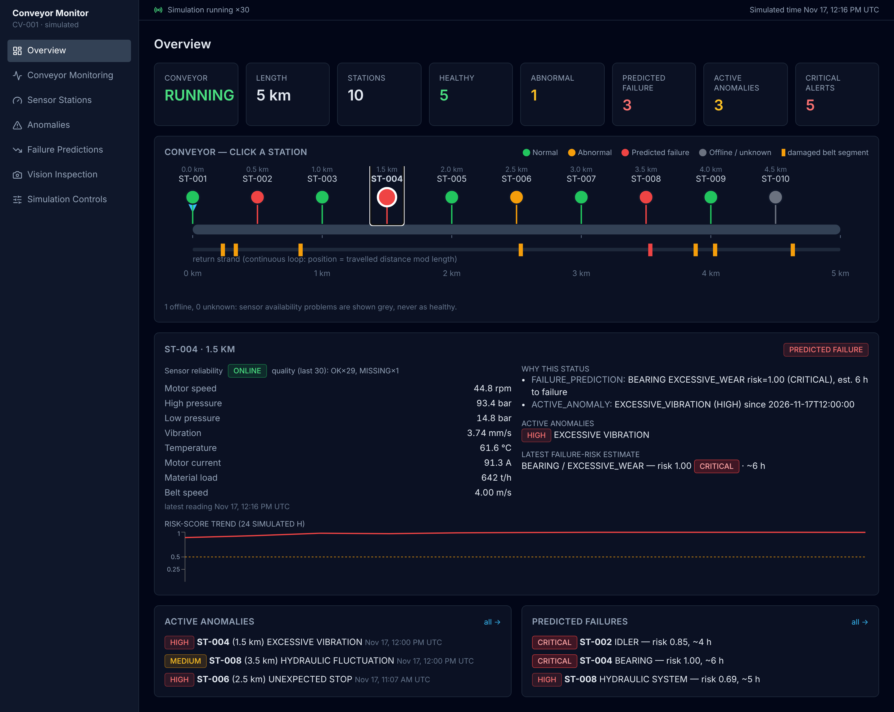
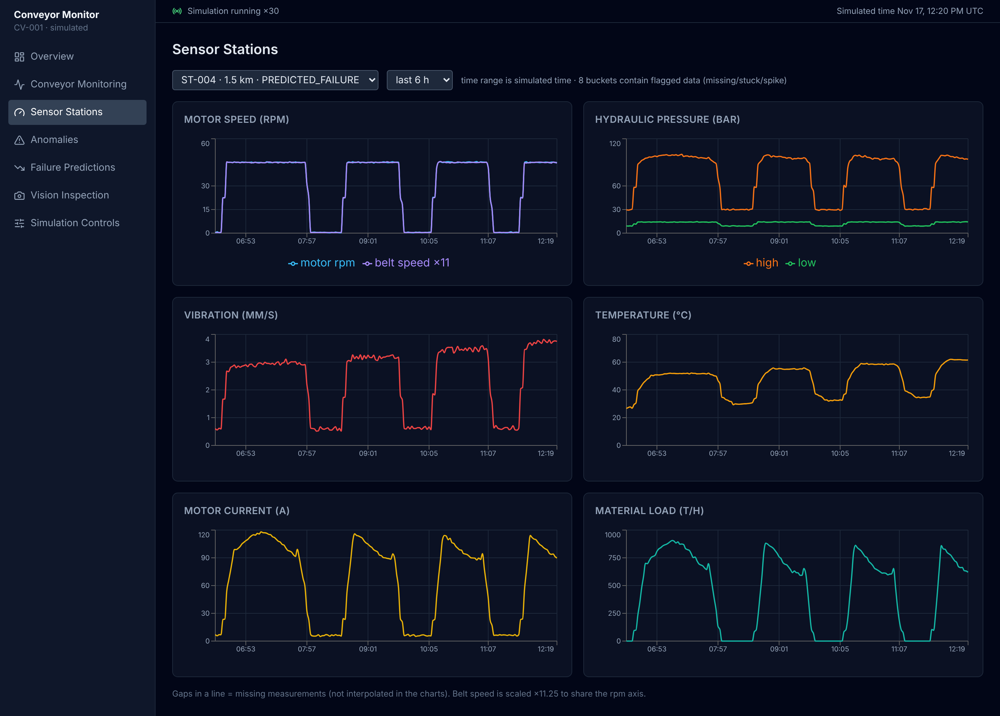
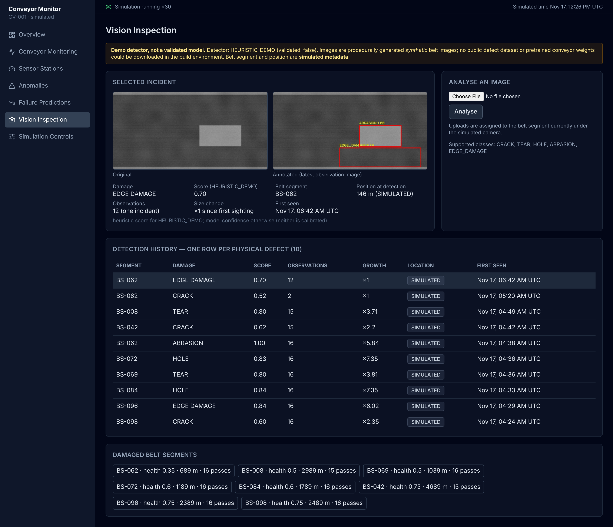

# Mining Conveyor Monitoring & Predictive Maintenance (simulated)

A software-only prototype that watches a simulated 5 km mining conveyor, flags abnormal operating behaviour, estimates which component may fail and when, looks for belt damage in images, and shows all of it on one dashboard.

Everything here runs on a CPU with no hardware. Sensor data comes from a simulator I wrote. Images are **synthetic**, because I could not download a real conveyor-defect dataset in the build environment (details in [Vision](#vision-component)).

> **Read this first: what is and isn't validated**
> - Anomaly detection and failure prediction were trained and tested **on simulator data only**. The scores below measure this pipeline, not a real conveyor, and are **not comparable to the research paper's published numbers**. Several are near 1.0 because the simulator is easy; see the caveats next to each.
> - The vision detector is a **hand-written OpenCV heuristic, not a trained or pretrained model**. It is a labelled stand-in, evaluated only on synthetic images that I also used to tune it.
> - Belt-segment positions are **simulated metadata**, never read from an image.

Documents: [architecture](docs/architecture/system-architecture.md) · [data flow](docs/architecture/data-flow.md) · [ML pipelines](docs/architecture/ml-pipeline.md) · [vision pipeline](docs/architecture/vision-pipeline.md) · [database](docs/architecture/database-design.md) · [state transitions](docs/architecture/state-transitions.md) · [API](docs/api/api-design.md) · [decisions](docs/decisions/architecture-decisions.md) · [research notes](research/methodology.md) · [status](IMPLEMENTATION_STATUS.md) · [AI usage](ai_usage/README.md)

## Dashboard

| | |
|---|---|
|  |  |
| Overview: every station coloured by health, with the reasons for the selected one | Per-station charts; vibration and temperature climb across duty cycles at ST-004 (simulated bearing wear) |
|  |  |
| Failure predictions with risk trend | Vision incidents, repeat sightings folded together |

More: [conveyor view](docs/screenshots/02-conveyor.png), [anomalies](docs/screenshots/04-anomalies.png), [simulation controls](docs/screenshots/07-simulation.png). These are screenshots of the running app, taken against the demo data the app generates at start-up.

## Quick start

```bash
python3 -m venv .venv && . .venv/bin/activate
pip install -r backend/requirements.txt
cd frontend && npm install && npm run build && cd ..
cd backend && python -m uvicorn app.main:app --port 8000     # http://localhost:8000
```

The backend serves the built dashboard and the API (docs at `/docs`). On start-up it generates 12 hours of simulated history with a few scenarios already running, then keeps simulating live (one tick every 2 s, 30× speed by default: one tick = one simulated minute). For frontend development run `npm run dev` in `frontend/` (proxies `/api` to port 8000).

Trained models are committed in `models/`. To retrain and regenerate the metrics files:

```bash
cd backend
python -m app.ml.anomaly_detection.train      # under a minute
python -m app.ml.failure_prediction.train     # ~3 min
python -m app.vision.evaluate                 # synthetic-image demo evaluation
python -m pytest tests -q                     # 56 tests
```

## The problem and my approach

A conveyor failure stops the whole operation. The task is to monitor a multi-kilometre belt and predict failures before they happen. I split that into five pieces and kept the boundaries explicit:

| Piece | What it answers | Source of truth |
|---|---|---|
| Simulator | what the sensors read | my code, seeded, with hidden ground truth |
| Anomaly detection (research Approach 2) | is this duty cycle behaving abnormally? | paper methodology, re-implemented |
| Failure-risk model | which component may fail, how soon? | my extension, trained on simulated degradation |
| Vision | is there visible belt damage, and is it a new defect or one seen before? | heuristic demo + tracking logic |
| Health engine | what colour is each station and why? | rules over all of the above, not one model |

I deliberately did **not** let one model decide station health. Anomalies (odd behaviour), predictions (possible future faults), sensor reliability and vision are different kinds of evidence with different failure modes, so the health engine combines them with explicit priority rules and stores the evidence so the dashboard can explain itself.

### Design decisions (short version; reasoning in [ADRs](docs/decisions/architecture-decisions.md))

- **Modular monolith, FastAPI + SQLite + React.** One process, no queue, no broker. The load is 5 readings/second. SQLAlchemy keeps PostgreSQL possible.
- **Polling every 2.5 s, no WebSockets.** Simpler, and the dashboard keeps its last data if the API drops.
- **Ingestion and inference are separate.** Ingestion only validates and stores. A background asyncio task (every 5 s, `INFERENCE_INTERVAL_S`) processes readings newer than each station's `last_processed_timestamp`, idempotently; no model runs in a request handler except the explicit `/api/vision/analyze` upload endpoint.
- **Two separate ML models.** The paper detects abnormal duty cycles; it does not predict component failure. Mixing them would pass off one as the other.
- **Ground truth lives outside the feature path.** The simulator returns labels in a separate table. Failure windows use only past data (tested).
- **Sensor problems are not equipment problems.** Missing, stuck or spiking values are flagged at ingestion, blanked before ML sees them, and show up as grey stations rather than anomalies.

## Simulator

`backend/app/simulator/engine.py`. 10 stations, 500 m apart over 5 km, nominal 45 rpm, an 18-hour operating window per day, seed 42; all configurable in `core/config.py`. These are prototype assumptions, not industrial specifications.

- **How values are produced:** each station has a schedule of operating modes (OFF → IDLE → OPERATIONAL → ACTIVE → OPERATIONAL → IDLE). Sensor values are a function of mode and time plus seeded noise, so sensors are correlated: more load means more current and hydraulic pressure and slightly lower speed; slippage makes belt speed diverge from motor speed; bearing wear raises vibration and temperature together.
- **Paper sensors vs extensions:** motor speed, high/low hydraulic pressure (and their difference) are the paper's. Vibration, temperature, current, load and belt speed are my additions and are labelled as such in `/api/sensors`.
- **Scenarios:** normal cycles; abnormal cycles (unexpected stop, abnormal start-up, intermittent operation); value anomalies (overload, hydraulic fluctuation, excessive vibration, belt slippage, over-temperature); six degradation scenarios plus hydraulic degradation; sensor faults (stuck, spike, dropout, disconnect). Random missing values are always on (0.2 % per channel). Sensor noise is configurable per channel; benign oddities (slow start-up, load spike, short pause) are generated as *normal*; value and cycle anomalies have LOW/MEDIUM/HIGH severity. Ground truth records all of it separately.
- **Assumption to flag:** the paper's sensors belong to one drive. I gave every station its own drive-like sensor set so the paper's method can run per station.
- **Reproducible:** same seed and call give identical data (tested).

## Anomaly detection (research Approach 2)

Reference: Martinez-Rau et al., *On-device Anomaly Detection in Conveyor Belt Operations*, [arXiv:2411.10729](https://arxiv.org/abs/2411.10729); official code: [lucianomrau/on_device_anomaly_detection_in_conveyor_belt_operations](https://github.com/lucianomrau/on_device_anomaly_detection_in_conveyor_belt_operations). I cloned the repo and read `approach2.ipynb`, `custom_functions.py` and `my_functions.py` before writing anything.

**Taken from the paper/code:** 1-minute sampling; features = speed, high/low pressure, differential pressure, plus centred rolling means of order 3 and 5 (12 features); a supervised state classifier (A off / B idle / C transition / D steady) with a 3-sample median filter; duty-cycle detection by thresholding smoothed speed at 2.5; extracting the non-repeated state sequence inside a cycle; pattern matching against `CDC` and `CD`; requiring idle (`B`) just before and after.

**My deviations (all intentional):**
1. Simulated data, so the 2.5 rpm threshold is calibrated to my simulator's idle noise, not equipment-specific.
2. `class_weight='balanced'` instead of SMOTE/under-sampling; fixed hyper-parameters from the paper's grid instead of a grid search.
3. Leading/trailing `A`/`B` are stripped from the sequence before matching (3-sample smoothing leaks idle rows into the cycle edges; the idle-margin check covers them separately).
4. A data gap around a cycle gives `INDETERMINATE`, not `ABNORMAL`. The paper treats missing data as abnormal; I don't think a dropped sensor should be reported as a faulty conveyor.
5. Added a category and severity (unexpected stop / abnormal start-up / intermittent operation) on top of the paper's binary label. Severity is a fixed rule, not learned.
6. Cycles cut off by the analysis window are skipped, which removed a false-alarm bug in streaming use.
7. Approach 3 (learned duty-cycle classifier) is not implemented.

Extension (not in the paper): `signal_checks.py` raises value-level anomalies (overload, slippage, vibration, temperature, hydraulic fluctuation) with plain threshold rules, because Approach 2 only sees cycle *structure*. Thresholds are calibrated to the simulator.

### How the evaluation avoids grading the simulator on its own rules

Because I wrote both the simulator and the models, a model can score well just by relearning my generator. The protocol below is meant to make that harder (it cannot remove it):

- **Noise and oddities.** Test data has 1.5× sensor noise (per-channel multipliers are configurable). 25 % of normal cycles carry a *benign oddity labelled normal*: slow start-up (8–14 min ramp), brief load spike (1–3 min, +30 % load), or a short mid-cycle pause (1.5–3 min).
- **Subtle anomalies with severities.** Value anomalies (overload, hydraulic fluctuation, vibration, slippage, over-temperature) come in LOW / MEDIUM / HIGH; LOW is close to normal variation. Cycle anomalies scale with severity too (number and length of stop-go dips; length of the unexpected stop).
- **Splits by seed, scenario and time, never by row.** Train = seed 42 first 14 days; validation = the following days of seed 42 (the only place a model is chosen); **test = two different seeds (2001, 2002)** with different station biases and noise. Training data never contains `INTERMITTENT_OPERATION` cycles or `SHORT_PAUSE` oddities (held out entirely). The deployed model is refit on train+validation only. Rule thresholds in `signal_checks.py` were set while looking at seed-42 normal ranges and not changed after seeing test results.
- **Reported per scenario and per severity**, plus false-positive rate on each benign variant.

> **All results below are on synthetic simulator data. They measure this pipeline only and are not comparable to the paper's published numbers** (different data, different task framing, different splits).

**Approach 2 results (test seeds 2001+2002, 2,924 cycles, 422 abnormal; full file `models/anomaly_detection/metrics.json`).** Classifier chosen on validation: decision tree (abnormal-cycle F1 on validation: DT 0.965, ExtraTrees 0.960, RF 0.950, MLP 0.888).

| | Value |
|---|---|
| Precision / recall / F1 (abnormal) | **0.662 / 0.967 / 0.786** |
| False-positive rate / false-negative rate | **0.083** / 0.033 |
| Confusion (TP / FP / FN / TN) | 408 / 208 / 14 / 2,294 |
| State classifier macro-F1 (two seeds) | 0.984, 0.984 |
| Inference | ~20 ms for a 6-hour window of one station (includes feature extraction) |

| Recall by scenario | | Recall by severity | | FPR on normal cycles by variant | |
|---|---|---|---|---|---|
| Abnormal start-up | 0.925 | LOW | 0.922 | no oddity | 0.003 |
| Intermittent operation (held out of training) | 0.986 | MEDIUM | 0.985 | slow start-up | 0.000 |
| Unexpected stop | 0.992 | HIGH | 0.988 | load spike | 0.000 |
| | | | | **short pause** | **0.967** |

What this says: the paper's pattern-matching rule treats a healthy 2-minute pause in the middle of a cycle as an intermittent-operation anomaly (97 % of those were flagged), which is where nearly all false positives come from. That is a real limitation of the rule, and the test only shows it because I added benign pauses. Recall is high across severities because cycle anomalies change the state sequence in a very structured way.

**Rule-based value checks (my extension) are weak under this protocol.** Mean recall by severity across the five anomaly kinds: LOW 0.04, MEDIUM 0.32, HIGH 0.51 (per kind and severity in the metrics file; e.g. motor overload is almost never caught), with a 6.4 % false-alarm rate on normal 30-minute windows. The thresholds were calibrated at noise ×1.0 and do not hold at ×1.5. I did not retune them on the test data. They should be treated as a placeholder, not a detector.

**Why the high numbers need a caveat (logged in `IMPLEMENTATION_STATUS.md`).** State macro-F1 of 0.984 looks excellent, but a three-line speed-threshold rule already scores 0.955 on the same data, while a classifier trained on shuffled labels scores 0.199. So there is no leakage, but the state task is too easy: simulator modes differ strongly in speed. Cycle recall near 0.99 for the structured anomalies is for the same reason.

## Failure-risk prediction (my extension)

`backend/app/ml/failure_prediction/`. Per station, at 15-minute window ends, features come from the previous 60 minutes (vibration stats and slope, temperature trend, current trend, pressure deviation, slip, load, running fraction) and previous 12 hours (drift), plus running hours and rule-flag counts over 24 h. Windows with under 15 running samples produce no prediction. Classes: normal plus seven degradation scenarios, mapped to six components. A separate gradient-boosting regressor estimates hours to failure and is only returned when risk ≥ 0.5.

Protocol as above: train seed 42 (episodes days 1–15, profiles linear/accelerating), validation = a second seed's later days (candidate chosen here: random forest, macro-F1 0.913 vs ExtraTrees 0.846 vs gradient boosting 0.751), test = seeds 2001/2002 with 1.5× noise, benign oddities, severity-graded anomalies and sensor faults as hard negatives, and a **held-out degradation profile** (`early_onset`) never seen in training. Windows with degradation level 0 < L < 0.25 are dropped (my choice of "not yet detectable"). Degradation severity buckets: LOW 0.25–0.5, MEDIUM 0.5–0.75, HIGH ≥ 0.75 of the way to failure.

| Test (8,892 normal + 683 fault windows) | Value |
|---|---|
| Accuracy / macro-F1 | 0.970 / **0.769** |
| Fault windows flagged at risk ≥ 0.5 | 0.990 |
| False-alarm rate on normal windows (includes benign/hard negatives) | **0.027** |
| Time-to-failure MAE vs predict-the-mean baseline | **4.52 h vs 4.77 h** |

| Class recall by severity | | Class recall by scenario | | Per-component F1 | |
|---|---|---|---|---|---|
| LOW | 0.753 | belt tension | 1.00 | belt | 0.94 |
| MEDIUM | 0.856 | hydraulic | 1.00 | bearing | 0.82 |
| HIGH | 0.900 | belt abrasion | 0.94 | hydraulic | 0.79 |
| | | motor overheating | 0.91 | drive motor | 0.72 |
| | | bearing | 0.86 | pulley | 0.55 |
| | | pulley | 0.67 | idler | **0.40** |
| | | idler | **0.45** | | |

- **Detection is good, diagnosis is not.** Almost every fault window is flagged (0.99), but naming the component is much worse for bearing / pulley / idler, which all show up as extra vibration. Idler F1 is 0.40. The UI therefore shows the component as the model's best guess.
- **The time-to-failure estimate is barely better than guessing the average** (4.52 h vs 4.77 h MAE on held-out seeds). Earlier numbers that looked much better (1.8 h vs 3.1 h) came from a protocol where train and test shared seed and noise; that was the circularity the update asked me to remove. Treat the ETA in the dashboard as indicative only.
- **Held-out scenario:** a model trained without `belt_abrasion` flags 86 % of its windows as risky, but names them as pulley (86 of 101). It notices "something is wrong" without having seen the fault, which is the useful behaviour, and can't name it, as expected.
- **Held-out profile:** `early_onset` windows score high (class recall 0.97) mostly because that profile reaches high degradation levels quickly, so the comparison by profile is confounded with severity. I would not read it as generalisation evidence.
- `risk_score` is `1 − P(normal)` from the classifier. It ranks windows, it is not a calibrated probability, and the API/UI say so. The test period has only two episodes per scenario per seed, so per-scenario numbers are noisy. A sustained injected vibration anomaly can look like idler wear (visible on ST-002 in the demo); I left it in because it is a real limitation.


## Vision component

**Dataset: not obtained.** The task asks for a public dataset from Kaggle or elsewhere. In this build environment the network policy blocked Kaggle, Hugging Face, Roboflow and Zenodo (every attempt returned 403 from the proxy), and a GitHub search turned up only unlicensed repositories and "sponsor to obtain the data" listings. I did not use those, and I am not going to name a dataset or quote statistics I could not verify. Details of what I tried are in [research/dataset_analysis.md](research/dataset_analysis.md).

**What I built instead:**
- `vision/synth.py` generates procedural belt images (crack, tear, hole, abrasion, edge damage, plus clean belt) with known bounding boxes: 8 "damaged segments" × 3 wear stages + 6 clean images (`data/vision/samples/`). They are cartoonish and **are not real belt photographs**.
- `vision/detector.py` defines the detector interface. `UltralyticsDetector` loads a YOLO `.pt` from `models/vision/conveyor_defect.pt` if `ultralytics` is installed, reports only supported conveyor-defect classes and runs on CPU. **I could not test it** (no weights, no torch). `HeuristicDemoDetector` is the active fallback: background subtraction + contour shape rules. Every API response and the UI mark it `HEURISTIC_DEMO`, `validated: false`.
- Demo evaluation on the synthetic set (30 images, tuned on the same images, so it flatters the heuristic): crack 6 TP / 1 FP, tear 6/0, hole 6/0, abrasion 3/0, edge damage 3/1, no false detections on clean images, 0 misses (`models/vision/demo_eval.json`). Nothing here says how it would do on real belts, which have dirt, lighting changes and texture the synthetic images lack.

**To make this real:** pick a licensed public conveyor-defect dataset, hold out a test split, drop weights into `models/vision/`, install CPU torch + ultralytics, evaluate, then flip `validated`. The surrounding pipeline needs no changes.

### The continuous-loop problem

A looping belt means one camera sees the same physical belt over and over, so I assumed these consequences and handled what I could:

| Consequence | What the system does |
|---|---|
| The same segment is photographed every loop (here every ~21 min at 4 m/s) → the same defect would be reported again and again | The belt is split into 100 permanent segments (`BS-000…099`). Each detection is matched to prior incidents on **segment + class + bounding-box overlap or containment**; a match becomes a repeat observation of the existing incident (`observation_count`), not a new one. Verified in tests and visible in the UI (one row per defect with its observation count). |
| A defect gets bigger between passes, so its box no longer overlaps the old one | Matching accepts containment as well as IoU (a bug my own test caught: IoU alone filed a growing tear as a second defect). Size change is stored (`first_area`, `latest_area`) and shown as growth. |
| A static image carries no position | Position is *derived*: `belt_position = (segment_origin + travelled_distance) % length`, with travelled distance integrated from the simulated belt speed. Every record carries `location_source` (`SIMULATED` / `USER_SUPPLIED` / `UNKNOWN`). |
| Segments move, so "where is it now" changes | Segment positions are recomputed from travelled distance; the dashboard draws damaged segments moving along the belt. |
| Belt speed changes, several segments may pass in one tick | The tracker returns every segment that crossed the camera in a step (tested for large steps). |

**Not solved (chosen not to, or out of time):** odometry drift (real slippage means integrated speed ≠ true travel; a splice or reference mark would be needed to re-sync); the camera only sees one face of the belt, the underside and return strand are blind; no multi-pass confirmation before raising an incident (one false positive becomes an incident); no lighting/dirt robustness; segment identity is lost if the belt model is reset.

## Data quality and messy input

Readings are validated on ingestion (`services/quality.py`): missing channel, full disconnect, out-of-range, spike, stuck value (12 identical readings on a noisy channel), non-increasing timestamp. Each reading is stored with its status. Before ML, readings with quality problems are blanked; short gaps (≤ 5 min) are linearly interpolated for the paper's features, longer gaps stay gaps and make a cycle `INDETERMINATE`. Sensor health (`ONLINE / DEGRADED / OFFLINE`) comes from the last 30 readings and data age. An offline sensor turns the station grey; it is never shown as healthy and never raised as an equipment anomaly (tested). Chart gaps are real missing values, not interpolated.

## Health engine

Priority, highest first: `OFFLINE` (stale/disconnected) → `PREDICTED_FAILURE` (risk ≥ 0.5 in the last 3 simulated hours) → `ABNORMAL` (active anomaly) → `UNKNOWN` (too few valid readings or degraded sensor) → `NORMAL`. Vision does not change station status (camera location is simulated). The evidence list is saved on the station row and returned by `/api/stations/{id}/health`.

## Database and API

SQLite via SQLAlchemy 2, schema in `backend/app/database/models.py`, Alembic migration `0001` (tested by running `alembic upgrade head`). Entities: Conveyor, SensorStation, SensorReading, OperatingCycle, Anomaly, FailurePrediction, BeltSegment, VisionDetection (diagram in [database-design](docs/architecture/database-design.md)). Images stay on disk; only paths are stored. Additions beyond the spec are listed there.

API (full list in [api-design](docs/api/api-design.md), interactive docs at `/docs`): `/api/health`, `/api/dashboard/summary`, `/api/conveyors[/{id}[/stations]]`, `/api/sensors[/{station}/readings]`, `/api/stations/{id}/health`, `/api/anomalies`, `/api/predictions`, `/api/vision/{detections,segments,analyze,info,samples}`, `/api/simulation/{status,start,stop,reset,speed,step,scenarios}`. List endpoints paginate and filter; errors are 404/422 with messages.

## Testing

`backend/tests`: 56 tests, all passing at the time of writing: simulator (positions, reproducibility, correlations, ground-truth separation, transitions), anomaly pipeline (features, gaps, pattern matching, unexpected-stop, incomplete cycles), failure model (no label leakage, past-only features, temporal split, shipped model sanity), vision (loading, CPU inference, tracker modulo logic, duplicate handling), and the API end to end with a real SQLite file (ingestion, persistence, pagination, scenario injection → anomaly → station status, quality handling). I also ran the full app and drove it through a browser. No test covers the frontend code itself.

## Assumptions and limitations

- All numbers are synthetic; thresholds are calibrated to the simulator.
- **Known interaction bug:** a degrading hydraulic system lowers idle pressure, the state classifier reads idle as "off", and Approach 2 reports a false `UNEXPECTED_STOP` (visible on ST-008 in the demo). Details in `IMPLEMENTATION_STATUS.md`.
- Python 3.13 was used (spec said 3.12); not tested on 3.12.
- shadcn/ui was not installed; `components/ui.tsx` has a few hand-written Tailwind components in that style.
- No authentication, no retention policy (at 10 stations × 0.5 Hz readings grow ~430k rows per real-time day), SQLite single-writer.
- `reset` wipes the database.
- Docker/Compose, Approach 3, quantisation, evaluation plots (matplotlib figures) and WebSockets were not done.

## What I would do differently with more time

1. Get a real, licensed conveyor-defect dataset and weights, evaluate on a held-out split, and replace the heuristic.
2. Validate the failure model on something other than my own simulator (public bearing run-to-failure data, for example), and calibrate the risk score.
3. Use more degradation episodes with randomised physics so the model cannot just learn my simulator's equations; evaluate with episode-grouped cross-validation instead of a single split.
4. Re-sync belt position from splice detection; require confirmation across passes; model both belt faces.
5. Move readings to a time-series store with retention/downsampling; add auth; add frontend tests.
6. Implement Approach 3 and compare against Approach 2 properly.

## References

- Martinez-Rau, Zhang, Oelmann, Bader. *On-device Anomaly Detection in Conveyor Belt Operations.* arXiv:2411.10729 (2024). Code: github.com/lucianomrau/on_device_anomaly_detection_in_conveyor_belt_operations
- Earlier version of the method: *TinyML anomaly detection for industrial machines with periodic duty cycles*, Sensors Applications Symposium 2024 (cited from the repo's README).
