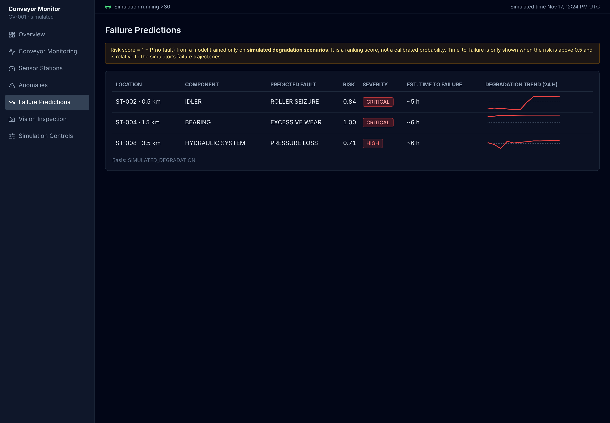

# Mining Conveyor Monitoring & Predictive Maintenance (simulated)

A software-only prototype that watches a simulated 5 km mining conveyor, flags abnormal operating behaviour, estimates which component may fail and when, looks for belt damage in images, and shows all of it on one dashboard.

Everything here runs on a CPU with no hardware. Sensor data comes from a simulator I wrote. Images are **synthetic**, because I could not download a real conveyor-defect dataset in the build environment (details in [Vision](#vision-component)).

> **Read this first: what is and isn't validated**
> - Anomaly detection and failure prediction were trained and tested **on simulator data only**. The scores below say the code works and the simulator is learnable. They do not say anything about a real conveyor, and they do not reproduce the research paper's published results.
> - The vision detector is a **hand-written OpenCV heuristic, not a trained or pretrained model**. It is a labelled stand-in, evaluated only on synthetic images that I also used to tune it.
> - Belt-segment positions are **simulated metadata**, never read from an image.

Documents: [architecture](docs/architecture/system-architecture.md) · [data flow](docs/architecture/data-flow.md) · [ML pipelines](docs/architecture/ml-pipeline.md) · [vision pipeline](docs/architecture/vision-pipeline.md) · [database](docs/architecture/database-design.md) · [state transitions](docs/architecture/state-transitions.md) · [API](docs/api/api-design.md) · [decisions](docs/decisions/architecture-decisions.md) · [research notes](research/methodology.md) · [status](IMPLEMENTATION_STATUS.md) · [AI usage](ai_usage/README.md)

## Dashboard

| | |
|---|---|
|  |  |
| Overview: every station coloured by health, with the reasons for the selected one | Per-station charts; vibration and temperature climb across duty cycles at ST-004 (simulated bearing wear) |
|  |  |
| Failure predictions with risk trend | Vision incidents, repeat sightings folded together |

More: [conveyor view](docs/screenshots/02-conveyor.png), [anomalies](docs/screenshots/04-anomalies.png), [simulation controls](docs/screenshots/07-simulation.png). These are screenshots of the running app, taken against the demo data the app generates at start-up.

## Quick start

```bash
python3 -m venv .venv && . .venv/bin/activate
pip install -r backend/requirements.txt
cd frontend && npm install && npm run build && cd ..
cd backend && python -m uvicorn app.main:app --port 8000     # http://localhost:8000
```

The backend serves the built dashboard and the API (docs at `/docs`). On start-up it generates 12 hours of simulated history with a few scenarios already running, then keeps simulating live (one tick every 2 s, 30× speed by default: one tick = one simulated minute). For frontend development run `npm run dev` in `frontend/` (proxies `/api` to port 8000).

Trained models are committed in `models/`. To retrain and regenerate the metrics files:

```bash
cd backend
python -m app.ml.anomaly_detection.train      # under a minute
python -m app.ml.failure_prediction.train     # ~80 s
python -m app.vision.evaluate                 # synthetic-image demo evaluation
python -m pytest tests -q                     # 55 tests
```

## The problem and my approach

A conveyor failure stops the whole operation. The task is to monitor a multi-kilometre belt and predict failures before they happen. I split that into five pieces and kept the boundaries explicit:

| Piece | What it answers | Source of truth |
|---|---|---|
| Simulator | what the sensors read | my code, seeded, with hidden ground truth |
| Anomaly detection (research Approach 2) | is this duty cycle behaving abnormally? | paper methodology, re-implemented |
| Failure-risk model | which component may fail, how soon? | my extension, trained on simulated degradation |
| Vision | is there visible belt damage, and is it a new defect or one seen before? | heuristic demo + tracking logic |
| Health engine | what colour is each station and why? | rules over all of the above, not one model |

I deliberately did **not** let one model decide station health. Anomalies (odd behaviour), predictions (possible future faults), sensor reliability and vision are different kinds of evidence with different failure modes, so the health engine combines them with explicit priority rules and stores the evidence so the dashboard can explain itself.

### Design decisions (short version; reasoning in [ADRs](docs/decisions/architecture-decisions.md))

- **Modular monolith, FastAPI + SQLite + React.** One process, no queue, no broker. The load is 5 readings/second. SQLAlchemy keeps PostgreSQL possible.
- **Polling every 2.5 s, no WebSockets.** Simpler, and the dashboard keeps its last data if the API drops.
- **Two separate ML models.** The paper detects abnormal duty cycles; it does not predict component failure. Mixing them would pass off one as the other.
- **Ground truth lives outside the feature path.** The simulator returns labels in a separate table. Failure windows use only past data (tested).
- **Sensor problems are not equipment problems.** Missing, stuck or spiking values are flagged at ingestion, blanked before ML sees them, and show up as grey stations rather than anomalies.

## Simulator

`backend/app/simulator/engine.py`. 10 stations, 500 m apart over 5 km, nominal 45 rpm, an 18-hour operating window per day, seed 42; all configurable in `core/config.py`. These are prototype assumptions, not industrial specifications.

- **How values are produced:** each station has a schedule of operating modes (OFF → IDLE → OPERATIONAL → ACTIVE → OPERATIONAL → IDLE). Sensor values are a function of mode and time plus seeded noise, so sensors are correlated: more load means more current and hydraulic pressure and slightly lower speed; slippage makes belt speed diverge from motor speed; bearing wear raises vibration and temperature together.
- **Paper sensors vs extensions:** motor speed, high/low hydraulic pressure (and their difference) are the paper's. Vibration, temperature, current, load and belt speed are my additions and are labelled as such in `/api/sensors`.
- **Scenarios:** normal cycles; abnormal cycles (unexpected stop, abnormal start-up, intermittent operation); value anomalies (overload, hydraulic fluctuation, excessive vibration, belt slippage, over-temperature); six degradation scenarios plus hydraulic degradation; sensor faults (stuck, spike, dropout, disconnect). Random missing values are always on (0.2 % per channel).
- **Assumption to flag:** the paper's sensors belong to one drive. I gave every station its own drive-like sensor set so the paper's method can run per station.
- **Reproducible:** same seed and call give identical data (tested).

## Anomaly detection (research Approach 2)

Reference: Martinez-Rau et al., *On-device Anomaly Detection in Conveyor Belt Operations*, [arXiv:2411.10729](https://arxiv.org/abs/2411.10729); official code: [lucianomrau/on_device_anomaly_detection_in_conveyor_belt_operations](https://github.com/lucianomrau/on_device_anomaly_detection_in_conveyor_belt_operations). I cloned the repo and read `approach2.ipynb`, `custom_functions.py` and `my_functions.py` before writing anything.

**Taken from the paper/code:** 1-minute sampling; features = speed, high/low pressure, differential pressure, plus centred rolling means of order 3 and 5 (12 features); a supervised state classifier (A off / B idle / C transition / D steady) with a 3-sample median filter; duty-cycle detection by thresholding smoothed speed at 2.5; extracting the non-repeated state sequence inside a cycle; pattern matching against `CDC` and `CD`; requiring idle (`B`) just before and after.

**My deviations (all intentional):**
1. Simulated data, so the 2.5 rpm threshold is calibrated to my simulator's idle noise, not equipment-specific.
2. `class_weight='balanced'` instead of SMOTE/under-sampling; fixed hyper-parameters from the paper's grid instead of a grid search.
3. Leading/trailing `A`/`B` are stripped from the sequence before matching (3-sample smoothing leaks idle rows into the cycle edges; the idle-margin check covers them separately).
4. A data gap around a cycle gives `INDETERMINATE`, not `ABNORMAL`. The paper treats missing data as abnormal; I don't think a dropped sensor should be reported as a faulty conveyor.
5. Added a category and severity (unexpected stop / abnormal start-up / intermittent operation) on top of the paper's binary label. Severity is a fixed rule, not learned.
6. Cycles cut off by the analysis window are skipped, which removed a false-alarm bug in streaming use.
7. Approach 3 (learned duty-cycle classifier) is not implemented.

Extension (not in the paper): `signal_checks.py` raises value-level anomalies (overload, slippage, vibration, temperature, hydraulic fluctuation) with plain threshold rules, because Approach 2 only sees cycle *structure*. Thresholds are calibrated to the simulator.

**Results** (trained on days 1–18, tested on the last 10 days of a 28-day chronological split: 1,051 cycles, 164 abnormal; four of the paper's classifiers, XGBoost and Naive Bayes not run; full output in `models/anomaly_detection/metrics.json`):

| State classifier | State macro-F1 | Abnormal precision | Recall | F1 | FPR | FNR |
|---|---|---|---|---|---|---|
| **ExtraTrees (shipped)** | 0.987 | 1.000 | 0.970 | 0.985 | 0.000 | 0.030 |
| Random forest | 0.987 | 1.000 | 0.988 | 0.994 | 0.000 | 0.012 |
| Decision tree | 0.987 | 1.000 | 0.994 | 0.997 | 0.000 | 0.006 |
| MLP | 0.987 | 1.000 | 0.896 | 0.945 | 0.000 | 0.104 |

ExtraTrees was chosen before looking at results because it is the paper's microcontroller pick; the others did slightly better here. Confusion matrix for the shipped model: TP 159, FP 0, FN 5, TN 887 (the 5 misses are abnormal start-ups scored as normal). Inference: ~8.5 ms for a 6-hour window of one station. **Read these numbers sceptically:** my simulator's cycles are cleanly separated, so the task is easy. They show the pipeline works, nothing more.

## Failure-risk prediction (my extension)

`backend/app/ml/failure_prediction/`. Per station, every 30 minutes, features come from the previous 60 minutes (vibration stats and slope, temperature trend, current trend, pressure deviation, slip, load, running fraction) and previous 12 hours (drift), plus running hours and rule-flag counts over 24 h. Windows with under 15 running samples produce no prediction. Classes: normal plus seven degradation scenarios, mapped to six components. A separate gradient-boosting regressor estimates hours to failure, and the API only returns it when risk ≥ 0.5.

Temporal split (train until day 19.5, test after; 6,510 / 2,846 windows). Windows with degradation level 0 < L < 0.25 are excluded as "not yet detectable"; that threshold is my choice.

| Model | Accuracy | Macro-F1 | Fault recall @ risk 0.5 | False alarms on normal |
|---|---|---|---|---|
| **Random forest (shipped)** | 0.980 | 0.856 | 0.972 | 0.85 % |
| Extra trees | 0.975 | 0.839 | 0.935 | 0.81 % |
| Gradient boosting | 0.971 | 0.774 | 0.870 | 0.35 % |

Per component (shipped model): hydraulic system F1 0.98, conveyor belt 0.92, drive motor 0.79, pulley 0.77, idler 0.74, bearing 0.71. Bearing, pulley and idler all raise vibration, so they get confused with each other (see the confusion matrix in `models/failure_prediction/metrics.json`), and in the live demo the predicted component for a wearing bearing can flip between bearing/idler/pulley before settling. Time-to-failure MAE is 1.8 h against 3.1 h for a predict-the-mean baseline.

Caveats: the shipped model was picked by macro-F1 **on the test split**, so its numbers are slightly optimistic. The test period contains only two episodes per scenario (16 windows for belt tension), so per-component scores are noisy. `risk_score` is `1 − P(normal)` from the classifier. It ranks, but it is not a calibrated probability, and the API/UI say so. A sustained injected vibration anomaly can look like idler wear (visible on ST-002 in the demo); I left it in because it is a real limitation.

## Vision component

**Dataset: not obtained.** The task asks for a public dataset from Kaggle or elsewhere. In this build environment the network policy blocked Kaggle, Hugging Face, Roboflow and Zenodo (every attempt returned 403 from the proxy), and a GitHub search turned up only unlicensed repositories and "sponsor to obtain the data" listings. I did not use those, and I am not going to name a dataset or quote statistics I could not verify. Details of what I tried are in [research/dataset_analysis.md](research/dataset_analysis.md).

**What I built instead:**
- `vision/synth.py` generates procedural belt images (crack, tear, hole, abrasion, edge damage, plus clean belt) with known bounding boxes: 8 "damaged segments" × 3 wear stages + 6 clean images (`data/vision/samples/`). They are cartoonish and **are not real belt photographs**.
- `vision/detector.py` defines the detector interface. `UltralyticsDetector` loads a YOLO `.pt` from `models/vision/conveyor_defect.pt` if `ultralytics` is installed, reports only supported conveyor-defect classes and runs on CPU. **I could not test it** (no weights, no torch). `HeuristicDemoDetector` is the active fallback: background subtraction + contour shape rules. Every API response and the UI mark it `HEURISTIC_DEMO`, `validated: false`.
- Demo evaluation on the synthetic set (30 images, tuned on the same images, so it flatters the heuristic): crack 6 TP / 1 FP, tear 6/0, hole 6/0, abrasion 3/0, edge damage 3/1, no false detections on clean images, 0 misses (`models/vision/demo_eval.json`). Nothing here says how it would do on real belts, which have dirt, lighting changes and texture the synthetic images lack.

**To make this real:** pick a licensed public conveyor-defect dataset, hold out a test split, drop weights into `models/vision/`, install CPU torch + ultralytics, evaluate, then flip `validated`. The surrounding pipeline needs no changes.

### The continuous-loop problem

A looping belt means one camera sees the same physical belt over and over, so I assumed these consequences and handled what I could:

| Consequence | What the system does |
|---|---|
| The same segment is photographed every loop (here every ~21 min at 4 m/s) → the same defect would be reported again and again | The belt is split into 100 permanent segments (`BS-000…099`). Each detection is matched to prior incidents on **segment + class + bounding-box overlap or containment**; a match becomes a repeat observation of the existing incident (`observation_count`), not a new one. Verified in tests and visible in the UI (one row per defect with its observation count). |
| A defect gets bigger between passes, so its box no longer overlaps the old one | Matching accepts containment as well as IoU (a bug my own test caught: IoU alone filed a growing tear as a second defect). Size change is stored (`first_area`, `latest_area`) and shown as growth. |
| A static image carries no position | Position is *derived*: `belt_position = (segment_origin + travelled_distance) % length`, with travelled distance integrated from the simulated belt speed. Every record carries `location_source` (`SIMULATED` / `USER_SUPPLIED` / `UNKNOWN`). |
| Segments move, so "where is it now" changes | Segment positions are recomputed from travelled distance; the dashboard draws damaged segments moving along the belt. |
| Belt speed changes, several segments may pass in one tick | The tracker returns every segment that crossed the camera in a step (tested for large steps). |

**Not solved (chosen not to, or out of time):** odometry drift (real slippage means integrated speed ≠ true travel; a splice or reference mark would be needed to re-sync); the camera only sees one face of the belt, the underside and return strand are blind; no multi-pass confirmation before raising an incident (one false positive becomes an incident); no lighting/dirt robustness; segment identity is lost if the belt model is reset.

## Data quality and messy input

Readings are validated on ingestion (`services/quality.py`): missing channel, full disconnect, out-of-range, spike, stuck value (12 identical readings on a noisy channel), non-increasing timestamp. Each reading is stored with its status. Before ML, readings with quality problems are blanked; short gaps (≤ 5 min) are linearly interpolated for the paper's features, longer gaps stay gaps and make a cycle `INDETERMINATE`. Sensor health (`ONLINE / DEGRADED / OFFLINE`) comes from the last 30 readings and data age. An offline sensor turns the station grey; it is never shown as healthy and never raised as an equipment anomaly (tested). Chart gaps are real missing values, not interpolated.

## Health engine

Priority, highest first: `OFFLINE` (stale/disconnected) → `PREDICTED_FAILURE` (risk ≥ 0.5 in the last 3 simulated hours) → `ABNORMAL` (active anomaly) → `UNKNOWN` (too few valid readings or degraded sensor) → `NORMAL`. Vision does not change station status (camera location is simulated). The evidence list is saved on the station row and returned by `/api/stations/{id}/health`.

## Database and API

SQLite via SQLAlchemy 2, schema in `backend/app/database/models.py`, Alembic migration `0001` (tested by running `alembic upgrade head`). Entities: Conveyor, SensorStation, SensorReading, OperatingCycle, Anomaly, FailurePrediction, BeltSegment, VisionDetection (diagram in [database-design](docs/architecture/database-design.md)). Images stay on disk; only paths are stored. Additions beyond the spec are listed there.

API (full list in [api-design](docs/api/api-design.md), interactive docs at `/docs`): `/api/health`, `/api/dashboard/summary`, `/api/conveyors[/{id}[/stations]]`, `/api/sensors[/{station}/readings]`, `/api/stations/{id}/health`, `/api/anomalies`, `/api/predictions`, `/api/vision/{detections,segments,analyze,info,samples}`, `/api/simulation/{status,start,stop,reset,speed,step,scenarios}`. List endpoints paginate and filter; errors are 404/422 with messages.

## Testing

`backend/tests`: 55 tests, all passing at the time of writing: simulator (positions, reproducibility, correlations, ground-truth separation, transitions), anomaly pipeline (features, gaps, pattern matching, unexpected-stop, incomplete cycles), failure model (no label leakage, past-only features, temporal split, shipped model sanity), vision (loading, CPU inference, tracker modulo logic, duplicate handling), and the API end to end with a real SQLite file (ingestion, persistence, pagination, scenario injection → anomaly → station status, quality handling). I also ran the full app and drove it through a browser. No test covers the frontend code itself.

## Assumptions and limitations

- All numbers are synthetic; thresholds are calibrated to the simulator.
- Python 3.13 was used (spec said 3.12); not tested on 3.12.
- shadcn/ui was not installed; `components/ui.tsx` has a few hand-written Tailwind components in that style.
- No authentication, no retention policy (at 10 stations × 0.5 Hz readings grow ~430k rows per real-time day), SQLite single-writer.
- `reset` wipes the database.
- Docker/Compose, Approach 3, quantisation, evaluation plots (matplotlib figures) and WebSockets were not done.

## What I would do differently with more time

1. Get a real, licensed conveyor-defect dataset and weights, evaluate on a held-out split, and replace the heuristic.
2. Validate the failure model on something other than my own simulator (public bearing run-to-failure data, for example), and calibrate the risk score.
3. Use more degradation episodes with randomised physics so the model cannot just learn my simulator's equations; evaluate with episode-grouped cross-validation instead of a single split.
4. Re-sync belt position from splice detection; require confirmation across passes; model both belt faces.
5. Move readings to a time-series store with retention/downsampling; add auth; add frontend tests.
6. Implement Approach 3 and compare against Approach 2 properly.

## References

- Martinez-Rau, Zhang, Oelmann, Bader. *On-device Anomaly Detection in Conveyor Belt Operations.* arXiv:2411.10729 (2024). Code: github.com/lucianomrau/on_device_anomaly_detection_in_conveyor_belt_operations
- Earlier version of the method: *TinyML anomaly detection for industrial machines with periodic duty cycles*, Sensors Applications Symposium 2024 (cited from the repo's README).
