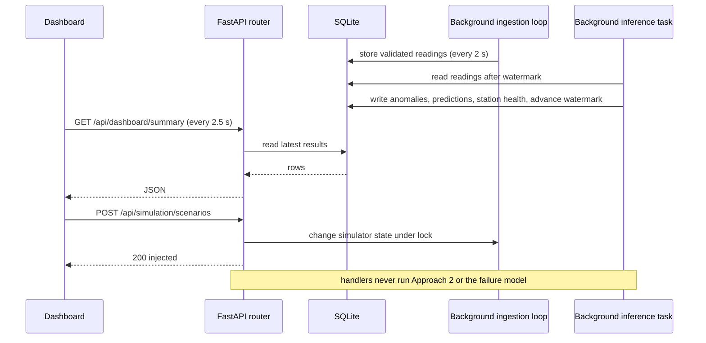

# API design

Base path `/api`, JSON, no authentication. Interactive docs at `/docs`. Lists paginate with `limit` / `offset` and return `{items, total, limit, offset}`. Validation errors are 422, unknown IDs 404, unexpected failures 500 with a generic message (details go to the log).

| Area | Endpoint | Notes |
|---|---|---|
| System | `GET /health` | model/detector status; vision detector is reported as `HEURISTIC_DEMO`, `validated:false` |
| | `GET /dashboard/summary` | counts per station status, active anomalies, critical alerts, conveyor status |
| Conveyor | `GET /conveyors`, `/conveyors/{id}`, `/conveyors/{id}/stations` | `{id}` is the UUID or the code (`CV-001`); stations include latest values and status evidence |
| Sensors | `GET /sensors` | channels per station, tagged `RESEARCH_PAPER` or `EXTENDED_SIMULATED`, plus sensor health |
| | `GET /sensors/{station}/readings?hours=&max_points=` | simulated-time window, bucket-averaged; flagged values excluded from means |
| | `GET /stations/{id}/health` | status, why, quality counts, active anomalies, latest prediction |
| Anomalies | `GET /anomalies?status=&severity=&station=&anomaly_type=` , `/anomalies/{id}` | `source` is `PAPER_APPROACH_2` or `SIGNAL_RULE` |
| Predictions | `GET /predictions?station=&component=&min_risk=&latest_only=`, `/predictions/{id}`, `/predictions/trend/{station}` | default: newest above-threshold prediction per station |
| Vision | `GET /vision/detections?incidents_only=&segment=&damage_type=`, `/vision/incidents/{id}/history`, `/vision/segments`, `/vision/info`, `/vision/samples`, `/vision/files/{path}` | |
| | `POST /vision/analyze` (multipart `file` or form `sample`, optional `segment_id`) | on-demand image analysis; the one endpoint that runs a model inside a request handler, because analysing an uploaded image is its purpose |
| Simulation | `GET /simulation/status`, `POST /start`, `/stop`, `/reset`, `/speed`, `/step?n=`, `GET/POST /scenarios` | `/step` and `/reset` only ingest; inference happens in the background task |

Scenario injection body: `{"type": "anomaly"|"degradation", "station_id": "ST-005", "kind": "BELT_SLIPPAGE", "duration": 3600, "severity": "LOW|MEDIUM|HIGH"}` (`duration` is seconds for anomalies, hours for degradations).

