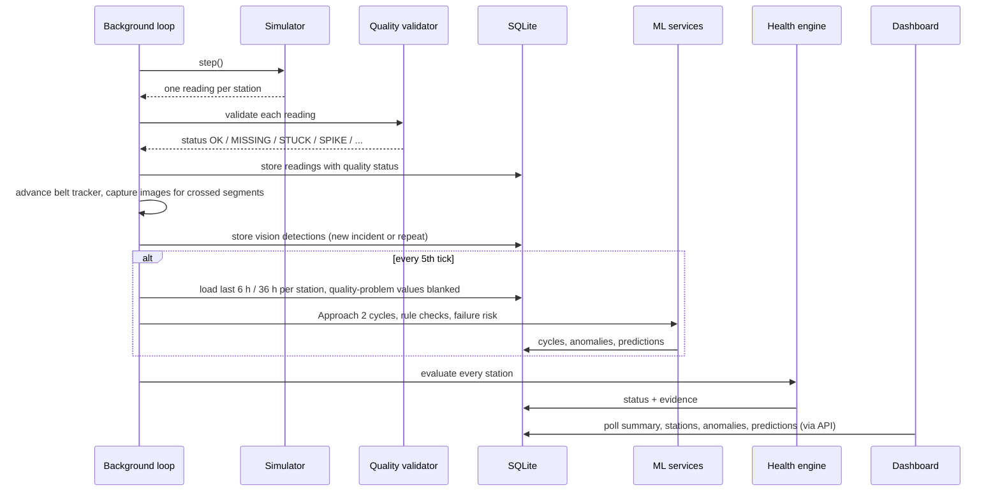

# Data flow

One live tick (default: every 2 s of wall time, advancing 60 s of simulated time):

Sensor data path in words: the simulator emits values with random missing entries and optional injected sensor faults. The validator labels each reading but never drops it; the label is stored. Before ML, readings labelled SPIKE, OUT_OF_RANGE, BAD_TIMESTAMP (whole row) or STUCK (the stuck channel) are set to missing, so a faulty sensor cannot look like a faulty conveyor. Missing values then go through short-gap interpolation (≤ 5 min) for Approach 2 features.

Warm start (`Pipeline.setup`) runs the same validator on 12 h of vectorised history, replays belt travel and camera captures over it, back-fills hourly failure predictions so risk trends exist, then switches to live stepping.
