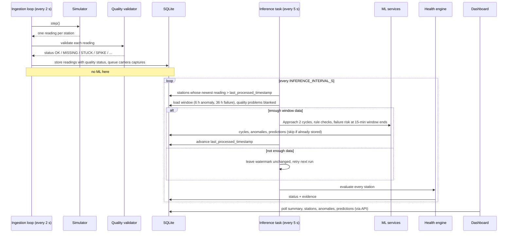

# Data flow

Ingestion and inference are **separate**. Ingestion only validates and stores. A background asyncio task, started in the FastAPI lifespan, runs every `INFERENCE_INTERVAL_S` seconds (default 5), picks up whatever each station has stored since its `last_processed_timestamp`, runs the models, persists results and advances the watermark. No ML runs inside a request handler or inside `tick()`.

Idempotency: a station with nothing newer than its watermark is skipped. Cycle anomalies are keyed by the deterministic cycle ID, value-rule anomalies by "already ACTIVE for this station and type", and predictions by a unique `(station_id, predicted_at)` constraint where `predicted_at` is a 15-minute window end, so re-running on the same data cannot duplicate anything (tested: two extra runs leave row counts unchanged). The unique constraint also caught an off-by-one in my own "already predicted" check during development.

Sensor data path in words: the simulator emits values with random missing entries and optional injected sensor faults. The validator labels each reading but never drops it; the label is stored. Before ML, readings labelled SPIKE, OUT_OF_RANGE, BAD_TIMESTAMP (whole row) or STUCK (the stuck channel) are set to missing, so a faulty sensor cannot look like a faulty conveyor. Missing values then go through short-gap interpolation (≤ 5 min) for Approach 2 features.

Warm start (`Pipeline.setup`) runs the same validator on 12 h of vectorised history and queues the camera captures. Its watermark is empty, so the first background run back-fills up to 10 h of 15-minute failure-risk windows (so risk trends exist) and analyses the queued captures. Nothing in `setup` runs a model.
