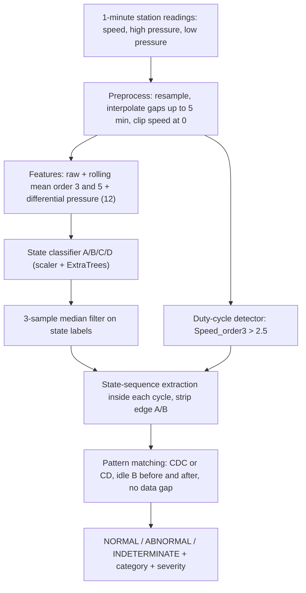
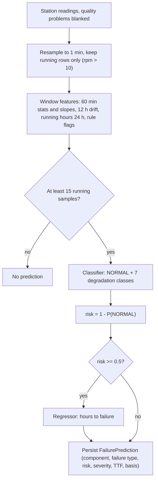

# ML pipelines

## Anomaly detection: research Approach 2

States are the paper's A (off), B (idle), C (transition), D (steady operation), mapped from the simulator's OFF, IDLE, OPERATIONAL, ACTIVE. Only the state classifier is learned; cycle detection and pattern matching are rules, as in the paper. Categories: `UNEXPECTED_STOP` (machine goes to A, not B, after the cycle), `ABNORMAL_STARTUP` (sequence begins with D), `INTERMITTENT_OPERATION` (two or more D runs), `OTHER_SEQUENCE`. Deviations from the official code are listed in the README and `research/methodology.md`.

A second, separate check (`signal_checks.py`) applies calibrated thresholds to the last 30 minutes for value-level anomalies. It is an extension and its source is stored as `SIGNAL_RULE` so the dashboard can tell the two apart.

## Failure-risk prediction

Training labels come from simulator ground truth: a window is labelled with a scenario if its degradation level at the window end is ≥ 0.25 and NORMAL if the level is 0 (ambiguous in-between windows are dropped). Hard negatives (overloads, slippage, injected vibration, sensor faults) are included as NORMAL. Features use only data up to the window end (tested). The severity bands are fixed: ≥ 0.8 CRITICAL, ≥ 0.65 HIGH, ≥ 0.5 MEDIUM, otherwise LOW.
