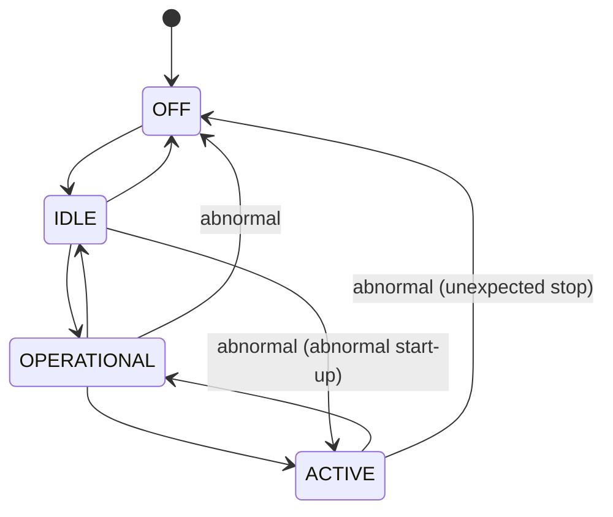
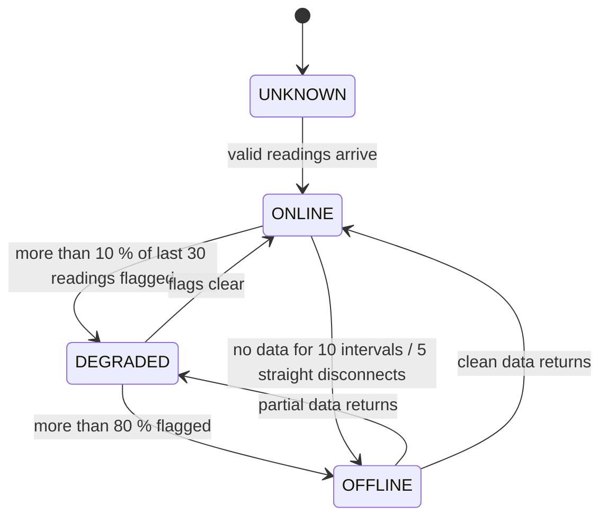
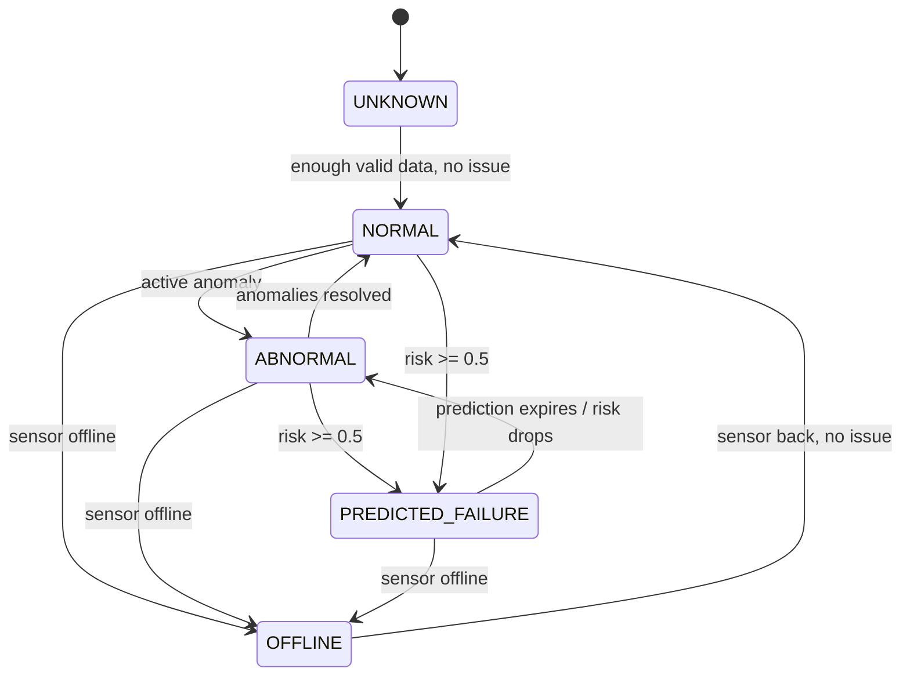

# State transitions

## Simulator operating modes

Normal duty cycle: IDLE → OPERATIONAL → ACTIVE → OPERATIONAL → IDLE, which Approach 2 sees as B C D C B. `is_valid_transition` and `ABNORMAL_TRANSITIONS` in `simulator/engine.py` encode these edges; a test checks that normal cycles use only valid ones.

## Sensor reliability

## Station health (output of the health engine)

Status is recomputed from scratch each tick by priority rules (OFFLINE > PREDICTED_FAILURE > ABNORMAL > UNKNOWN > NORMAL), so the arrows above describe what is possible, not a stored state machine.
