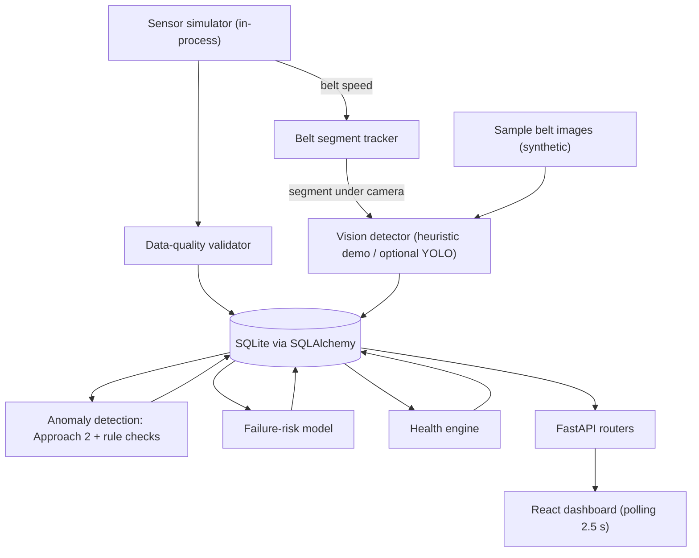

# System architecture

One Python process (FastAPI) owns the simulator, the ML inference, the vision service, the health engine and the SQLite database. The React dashboard is built to static files that the same process serves. There is no queue, broker or second service.

The simulator is the only source of non-vision data. The tracker turns simulated belt speed into "which belt segment is at the camera", and that segment ID is the only location information attached to a vision detection. Models are loaded once at start-up from `models/`; training is separate (`python -m app.ml.*.train`).

Module boundaries (`backend/app/`): `simulator/` (no DB access), `ml/anomaly_detection/` and `ml/failure_prediction/` (pandas in, results out, no DB access), `vision/` (OpenCV only), `services/` (the only layer that touches both models and DB: `pipeline.py`, `health.py`, `quality.py`, `vision_service.py`), `api/` (thin routers), `database/`, `schemas/`. The `repositories/` folder from the plan is unused; queries live in the routers and services because there were too few to justify another layer.
