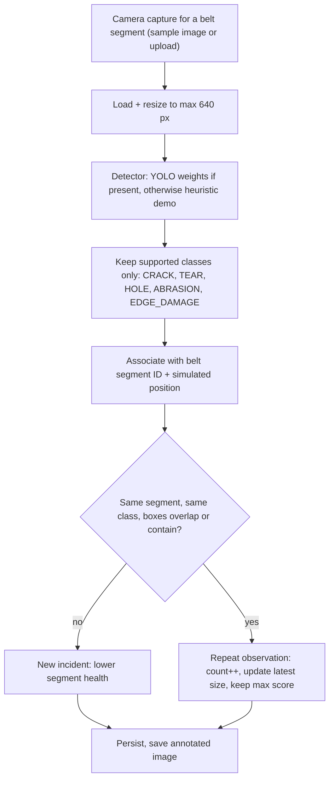
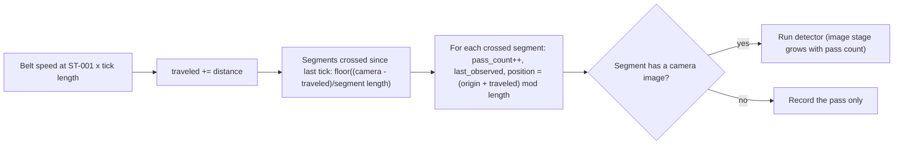

# Vision pipeline and belt tracking

## Belt segment tracking

The conveyor is 5,000 m with 100 segments of 50 m (`BS-000` to `BS-099`). The simulation marks 8 segments as damaged; each has three images of the same defect at growing size (wear stage = passes // 2, capped at 2). Segment position, camera position and the damage assignment are simulated. The `location_source` column says so on every record.

Matching rule (`vision.detector.same_defect`): IoU ≥ 0.3 **or** the smaller box is ≥ 70 % inside the larger one. The second condition exists because a growing defect has a low IoU against its earlier self.
